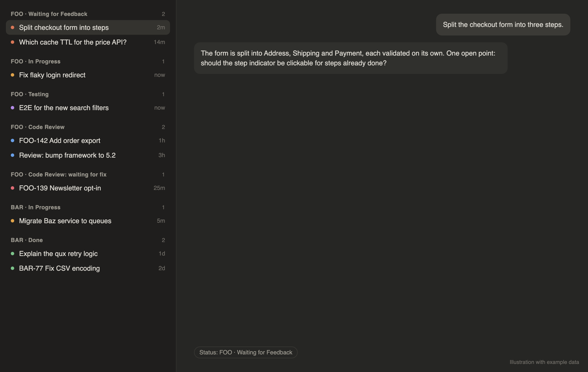
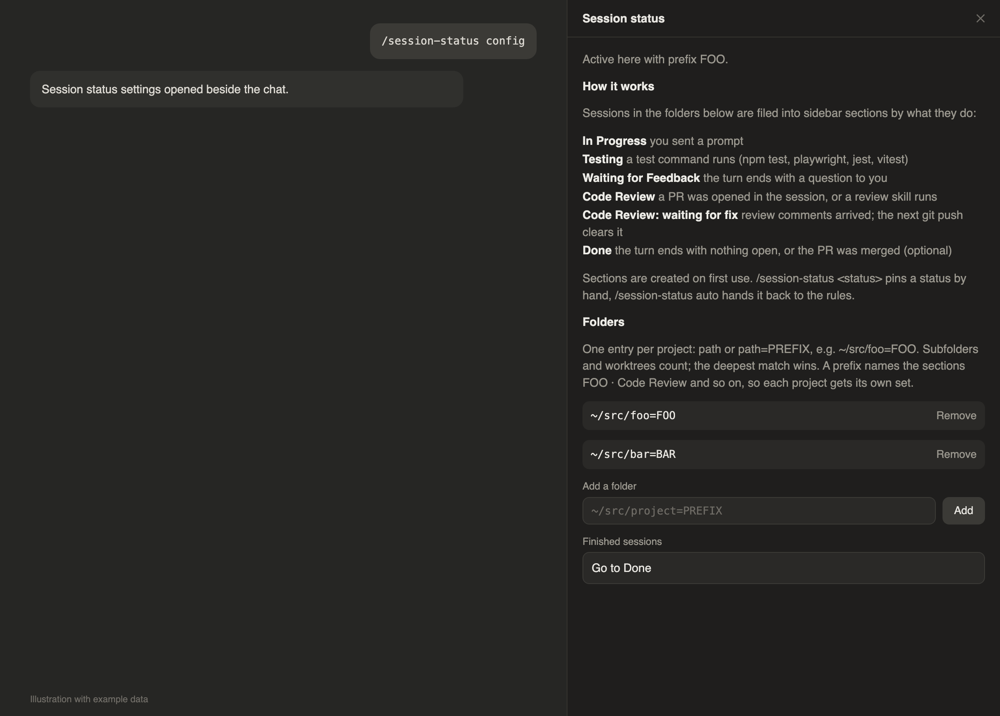
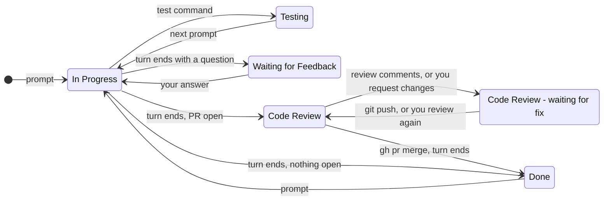

# session-status (beta)

A mod for the Claude Code desktop app that files each session in the Code tab's sidebar under a section named after what the session is doing: In Progress, Testing, Waiting for Feedback, Code Review, Code Review: waiting for fix, Done. With a few sessions per project running at once, the sidebar then reads like a board: you see at a glance which sessions wait for you and which sit in review.

It only acts in folders you list, and each folder can carry a prefix, so several projects in one account get their own sets of sections (`FOO · Code Review`, `BAR · Code Review`).



*Illustration with example data.*

> **Beta.** The rules work from what a session does (tool calls, the end of a turn, PR monitor events). They do not read your intent, so a session can land in the wrong section now and then; `/session-status <status>` puts it right by hand.

## Install

At the prompt of a Claude Code session:

```
/plugin install session-status --marketplace bate/claude-session-status
```

Answer `y` to add the marketplace, then pick a scope (user scope makes it work in every session). From a shell:

```bash
claude plugin install session-status --marketplace bate/claude-session-status
```

Then open the settings and add a folder (see below). With no folder configured the mod does nothing.

## Configure

Run `/session-status config` in any session. A pane opens beside the chat:



*Illustration with example data.*

- **Folders**: one entry per project, `path` or `path=PREFIX`, `~` allowed. A session counts when its working directory or repository root is that folder or lies below it, worktrees included. When folders nest, the deepest match wins, so `~/src=SRC` and `~/src/foo=FOO` can live side by side. A prefix names the folder's sections `PREFIX · <status>`; an entry without one gets plain names.
- **Add this folder**: shown in a session the mod is not active in yet, adds the folder the session runs in.
- **Finished sessions**: `Go to Done` (default) or `Stay in In Progress`.

The pane writes the plugin's options as the config menu would. The same options can be set with `/plugin configure session-status@session-status`, in the terminal's `/config` menu, or in `~/.claude/settings.json` under the installed plugin's key:

```json
"pluginConfigs": {
  "session-status@session-status": {
    "options": { "folders": "~/src/foo=FOO, ~/src/bar=BAR, ~/src/baz", "done": true }
  }
}
```

## What happens when

| Section | The session is filed there when |
| --- | --- |
| In Progress | you send a prompt |
| Testing | a test command starts (`npm test`, `npm run e2e`, `playwright test`, `jest`, `vitest`); the end of the turn files it again |
| Waiting for Feedback | `AskUserQuestion` is open, or the turn ends with a question to you: the app's next-step question, or an answer whose last lines end in `?` |
| Code Review | a review skill starts (`/pr:review`, `/code-review`, `diff-review`), or a turn ends after `gh pr create` succeeded in this session |
| Code Review: waiting for fix | as author: a PR monitor event about review comments or requested changes arrives; the next successful `git push` clears it. As reviewer: the session submits a review requesting changes (`gh pr review --request-changes`/`-r`, or `gh api …/pulls/N/reviews` with `REQUEST_CHANGES`); an approving review or the next review skill run clears it |
| Done | the turn ends with no question, no open PR, no pending fix and no background work still running (subagents, workflows, background shells), or after a successful `gh pr merge`. Off with the Done option: the session stays in In Progress |

At the end of each turn the mod decides in this order: a question to you wins, then a pending fix, then an open PR, then background work that still runs (In Progress), then Done. When that work reports back, the app wakes the session and the next turn end decides again.



Sections are created the first time they are needed, through the desktop app's own sidebar tools. Rename or reorder them as you like; a section whose name no longer matches is created again the next time the mod needs it. The current status also shows in the status line, after the plugin name the app puts in front.

## Pinning by hand

- `/session-status <in-progress|feedback|testing|review|review-fix|done>` pins the session to a status; the rules leave it alone from then on.
- `/session-status auto` hands it back to the rules.
- `/session-status` shows the current status.

## Requirements and limits

- Claude Code desktop app (Code tab). The sidebar tools exist only there; in the terminal or the IDE extensions the mod stays silent.
- Moving happens for the session the mod runs in, never for other sessions.
- Detection is rule-based: a test run through an unusual script, or a PR opened in the browser, is not noticed. Pin by hand in such cases.

## Develop

```bash
claude plugin validate .
claude plugin test .
```

The tests in `tests/` cover the rules, the folder matching with prefixes and the config pane on the terminal and desktop surfaces.

## License

MIT
